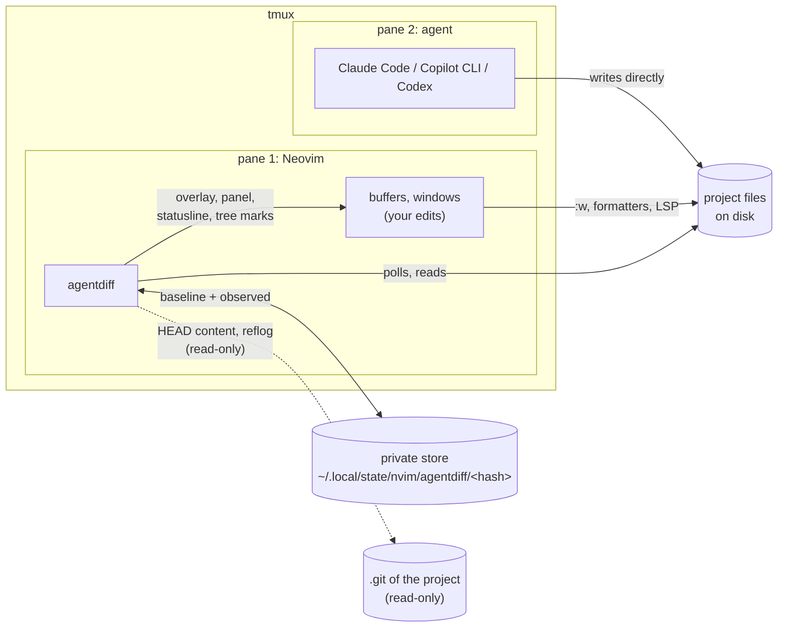
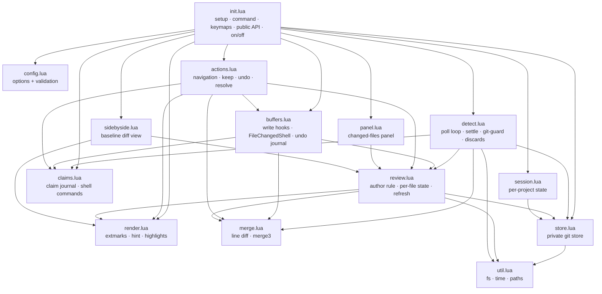
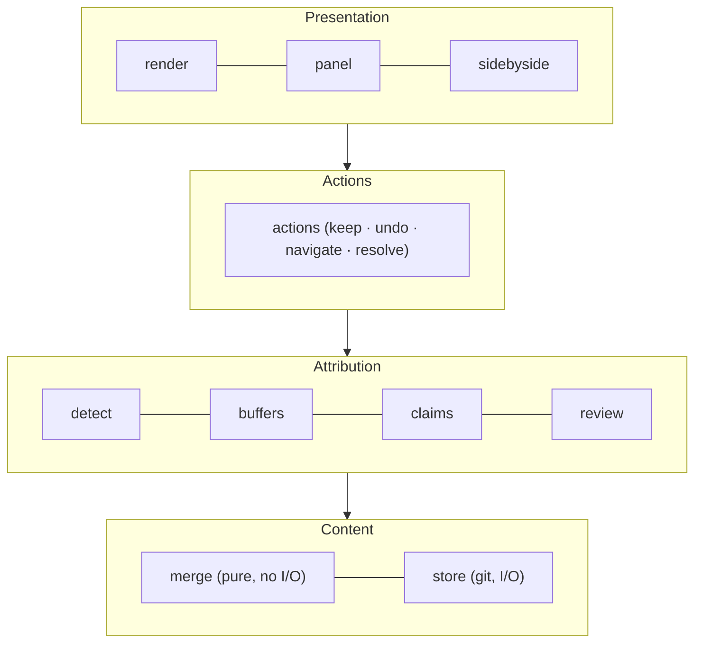
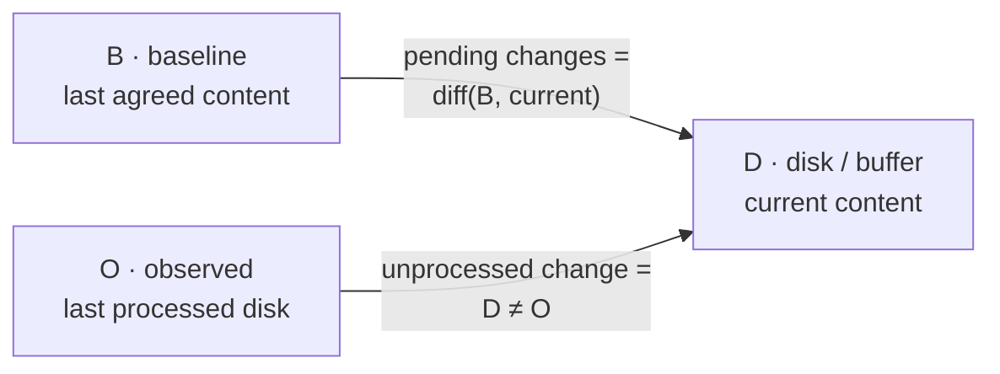
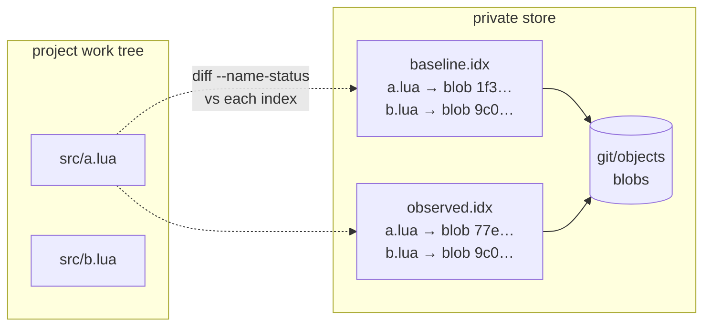
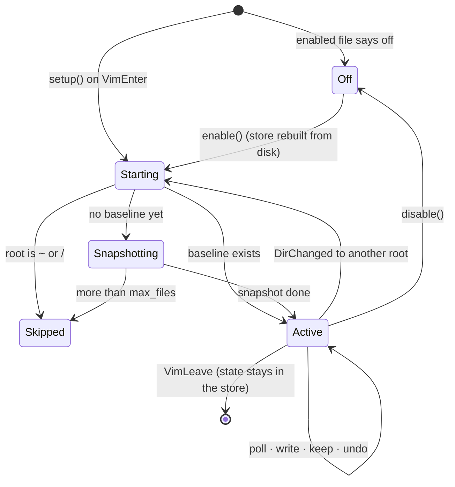

# Architecture

agentdiff is a single Lua plugin (`lua/agentdiff/`, ~3 800 lines in 14
modules) with no plugin dependencies. It needs only Neovim ≥ 0.12 and the
`git` executable, which it uses as a content-addressed store, never as a
version-control tool on your project.

- [The big picture](#the-big-picture)
- [Module map](#module-map)
- [Layers](#layers)
- [Data model: three texts per file](#data-model-three-texts-per-file)
- [The store on disk](#the-store-on-disk)
- [Session state](#session-state)
- [Lifecycle](#lifecycle)

## The big picture



The agent never talks to Neovim. agentdiff works out what the agent did by
comparing the disk against two snapshots it keeps in its own store, and by
knowing exactly what Neovim itself wrote (see [attribution](attribution.md)).

## Module map



| Module | Lines | Responsibility |
|---|---:|---|
| `init.lua` | 552 | `setup()`, `:Agentdiff`, optional keymaps, public API, persisted on/off state, test hooks |
| `actions.lua` | 493 | navigation, keep / undo at every scope (incl. line ranges), conflict resolution |
| `store.lua` | 483 | the private git store: sanitized git runner, the two indexes, snapshot, lock, read-only project queries |
| `buffers.lua` | 376 | Neovim's own writes, external changes to loaded buffers, conflicts, layout-preserving wipe, undo journal |
| `detect.lua` | 359 | poll timer, settle period, shell-command windows, git-guard, discard detection |
| `review.lua` | 310 | the author rule (`process`), per-file review state (`compute`), `refresh`, change events |
| `render.lua` | 257 | the inline overlay, the hint, change counting and navigation order |
| `merge.lua` | 212 | line arrays, hunks, three-way merge |
| `panel.lua` | 156 | the changed-files panel |
| `session.lua` | 145 | the running session: store, shared state, path ↔ buffer mapping, reviewable paths |
| `config.lua` | 134 | defaults, validation |
| `claims.lua` | 134 | the claim journal, shell command recognition |
| `sidebyside.lua` | 128 | the side-by-side baseline view, disk comparison for conflicts |
| `util.lua` | 69 | file I/O, wall-clock time, relative paths |

## Layers



- **Content**: `merge.lua` is pure (no I/O, no Neovim state) and fully unit
  tested; `store.lua` is the only module that runs git.
- **Attribution** decides *who* changed a file and updates the baseline
  accordingly. It's the heart of the plugin; see [attribution.md](attribution.md).
- **Actions** turn user intent (keep, undo) into baseline or file edits.
- **Presentation** only reads the review state and draws it.

## Data model: three texts per file

For every reviewable file agentdiff juggles three versions:

| Name | Where it lives | Meaning |
|---|---|---|
| **B**, baseline | `baseline.idx` in the store | the last content you agreed with |
| **O**, observed | `observed.idx` in the store | the last disk content agentdiff has processed |
| **D**, disk | the project file (or its buffer) | what is there now |



- **Pending changes** are always `diff(B, current)`.
- **Unprocessed changes** are files where `D ≠ O`: something wrote since the
  last look. Each one gets an author; the author decides whether B moves.

A buffer with unsaved edits is shown against a **display baseline**
`merge3(O, B, buffer)` computed in memory, so your unsaved typing is never
shown as pending either.

### Line arrays

All diffing works on line arrays where a trailing newline is an element of
its own:

```
"a\nb\n"  →  { "a", "b", "" }        "a\nb"  →  { "a", "b" }
nil (absent file)  →  { }            ""      →  { "" }
```

so `join(lines(t)) == t` for every text and "added a final newline" is an
ordinary one-element change. Files with `fileformat=dos` are compared without
their `\r` in buffers and re-encoded when written back.

## The store on disk

```
~/.local/state/nvim/agentdiff/
├── enabled                      "on <epoch>" / "off <epoch>"  (global on/off)
└── 3f2a9c0d81b4e7aa/            sha256(project root), first 16 hex chars
    ├── git/                     private git dir: objects only, never committed to
    │   └── info/
    │       ├── attributes       "* -text -filter -ident -diff -merge -crlf" → raw bytes
    │       └── exclude          plugin excludes + the project's .git/info/exclude
    ├── baseline.idx             index file = B for every file
    ├── observed.idx             index file = O for every file
    ├── claims/                  one file per claimed path: "<ms>\n<path>\n"
    ├── lock/                    mkdir-mutex around read-modify-write of B and O
    ├── epoch                    the on/off epoch this store was built in
    └── root                     the project root, for humans
```

Why a private git directory:

- **Content-addressed and deduplicated**: snapshotting a large project is cheap
  after the first time, and unchanged files cost nothing.
- **Fast change detection**: `git diff` against an index compares stat data
  first and only hashes files whose stat changed.
- **Free ignore handling**: git reads the project's `.gitignore` files from
  the work tree; nested repositories are reported as `dir/` and skipped.
- **Isolated**: every git process gets `--git-dir`, `--work-tree` and
  `GIT_INDEX_FILE` explicitly, with inherited `GIT_*` variables and the
  system/global config removed. The project's own `.git` is only ever read
  (with `GIT_OPTIONAL_LOCKS=0` so not even a stat refresh is written).



## Session state

One session per Neovim instance, for one project root (git toplevel, or the
cwd outside git; never `~` or `/` unless forced). Most of its state is
in-memory and rebuilt from the store:

| Field | Purpose |
|---|---|
| `files`, `order` | pending files and their navigation order (sorted paths) |
| `conflicts` | files whose agent write overlapped your unsaved edits |
| `writing` | paths Neovim is writing right now (between `BufWritePre` and `BufWritePost`) |
| `synced` | per buffer: the disk text the buffer last matched |
| `base_override` | per buffer: the base for your delta after `u` undid an agentdiff Undo |
| `journal` | per buffer: undo sequence numbers of agentdiff Undos |
| `views` | per buffer: the side-by-side baseline scratch buffer |
| `signature` | summary of the last state, so `User AgentdiffChanged` fires only on real changes |

## Lifecycle



- **Snapshotting** runs in the background (`git ls-files -o` into an empty
  index, then `update-index --add --stdin`); Neovim is usable at once and
  review becomes active when it finishes.
- **Enable after disable** rebuilds each project's store from the disk the
  first time that project is opened (the store's `epoch` no longer matches
  the global one), so nothing that changed while review was off is pending.
