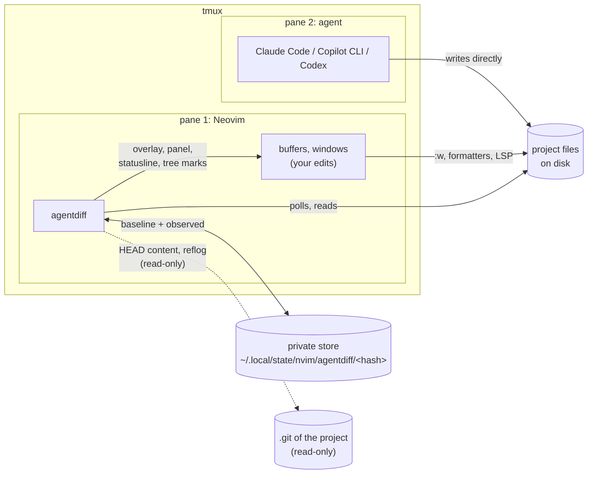
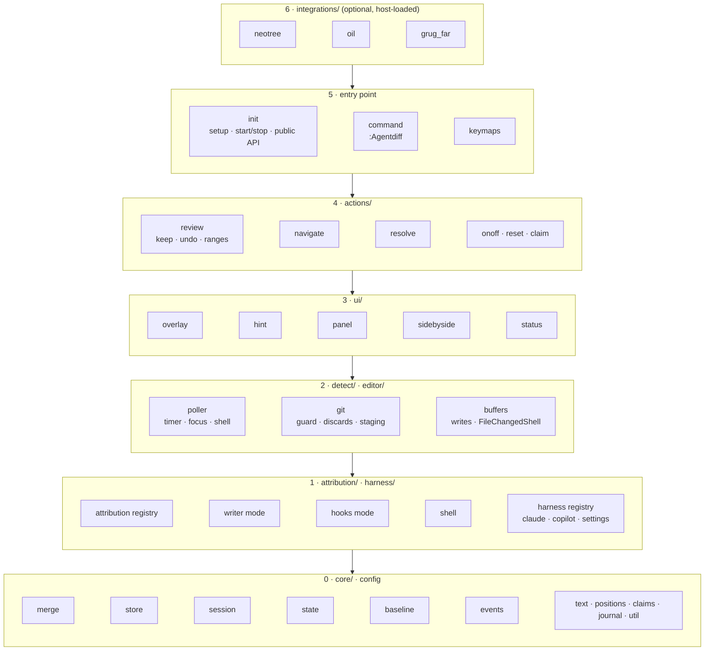
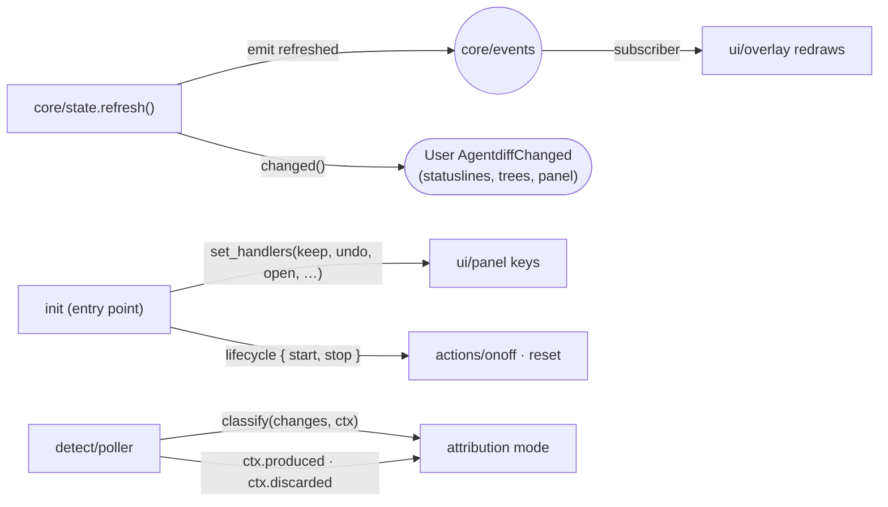
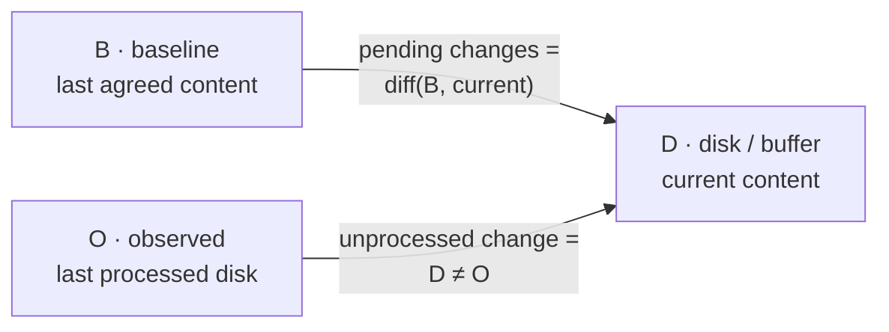
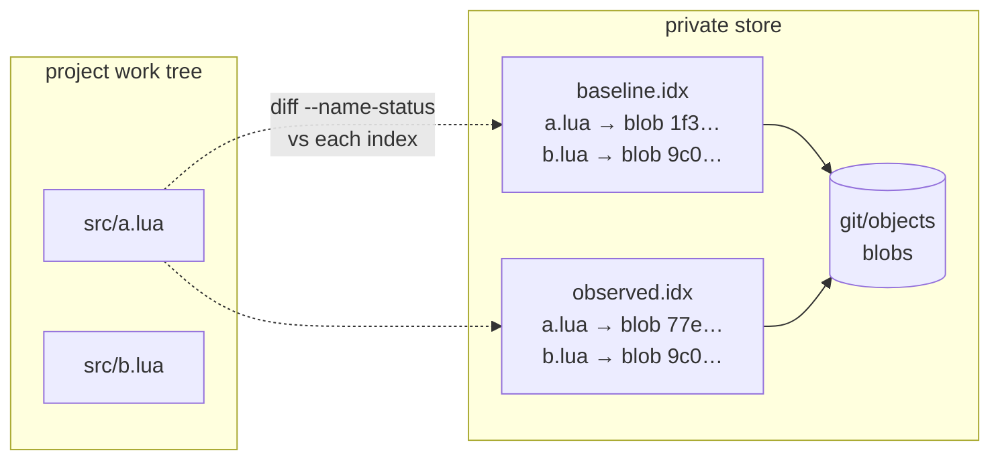
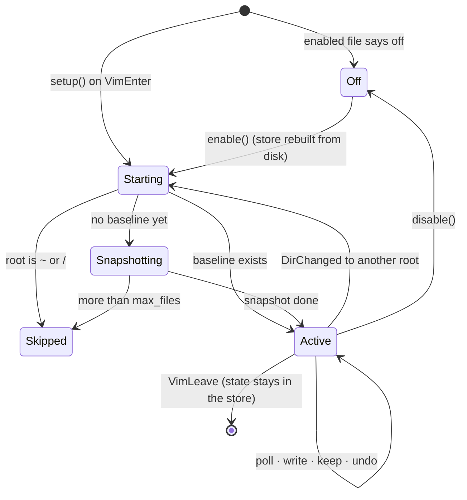

# Architecture

agentdiff is a single Lua plugin (`lua/agentdiff/`, ~4 600 lines in 37
modules) with no plugin dependencies. It needs only Neovim ≥ 0.12 and the
`git` executable, which it uses as a content-addressed store, never as a
version-control tool on your project.

- [The big picture](#the-big-picture)
- [Module map](#module-map)
- [How the layers talk](#how-the-layers-talk)
- [Data model: three texts per file](#data-model-three-texts-per-file)
- [The store on disk](#the-store-on-disk)
- [Session state](#session-state)
- [Lifecycle](#lifecycle)

## The big picture



The agent never talks to Neovim. agentdiff works out what the agent did by
comparing the disk against two snapshots it keeps in its own store, and by
knowing exactly what Neovim itself wrote (see [attribution](attribution.md)).

## Module map

37 modules in 8 directories, ~4 600 lines. Each directory is one concern, and
a module may only require modules on its own level or below; a test
(`tests/layers_spec.lua`) enforces it.



| Level | Directory | Modules | Responsibility |
|---:|---|---|---|
| 0 | `core/`, `config` | `merge` (212), `store` (528), `session` (145), `state` (154), `baseline` (146), `text` (81), `positions` (72), `claims` (71), `journal` (191), `events` (41), `util` (69), `config` (139) | content and state: the line model and merge3, the private git store, per-file review state, the author rule and baseline writes, the agent-report journal, change events |
| 1 | `attribution/` | `init` (67), `writer` (78), `hooks` (114), `shell` (70) | *who* changed a file: the mode interface and registry, the writer and hooks modes, shell-command recognition |
| 1 | `harness/` | `init` (65), `claude` (150), `copilot` (103), `payload` (106), `settings` (154) | the adapter interface and registry, one adapter per agent CLI, payload parsing and configuration-file editing |
| 2 | `detect/` | `poller` (218), `git` (189) | *when* to look: timer, focus, shell windows; read-only views of the project's git (guard, discards, staging-keeps) |
| 2 | `editor/` | `buffers` (371) | Neovim's own writes, external changes to loaded buffers, conflicts, the undo journal |
| 3 | `ui/` | `overlay` (114), `hint` (92), `panel` (174), `sidebyside` (123), `status` (75), `highlights` (15) | drawing; reads state, never changes the baseline |
| 4 | `actions/` | `review` (306), `navigate` (115), `resolve` (93), `onoff` (94), `reset` (30), `common` (49), `claim` (40), `hooks` (132) | user intent turned into baseline or file edits |
| 5 | entry point | `init` (356), `command` (150), `keymaps` (77) | setup, start/stop, the public API, `:Agentdiff`, optional keymaps |
| 6 | `integrations/` | `neotree` (72), `oil` (40), `grug_far` (20) | optional glue for other plugins; requires only the public `agentdiff` module |

## How the layers talk

Lower levels never call upward. Where a lower level has to notify a higher
one, it emits an event or calls a function that was handed to it:



- **The overlay** subscribes to the internal `"refreshed"` event instead of
  being called by the review state.
- **The panel's keys** call handlers the entry point injects, so `ui/` never
  requires `actions/` or the public module.
- **On/off and reset** restart the session through a `{ start, stop }`
  lifecycle passed in by the entry point.
- **The attribution mode** gets git helpers through its context, so a mode
  can use git-guard and discard detection without requiring `detect/`.

Outside the layers, `bin/agentdiff-hook.lua` is the hook reporter agent CLIs
run: a standalone `nvim -l` script that uses only `harness/` and
`core/journal`, never a session.

`core/merge.lua` is pure (no I/O, no Neovim state) and fully unit tested;
`core/store.lua` is the only module that runs git against the store, and
`detect/git.lua` the only one that reads the project's own repository.
See [extending.md](extending.md) for adding an attribution mode, a harness
adapter or an integration.

## Data model: three texts per file

For every reviewable file agentdiff juggles three versions:

| Name | Where it lives | Meaning |
|---|---|---|
| **B**, baseline | `baseline.idx` in the store | the last content you agreed with |
| **O**, observed | `observed.idx` in the store | the last disk content agentdiff has processed |
| **D**, disk | the project file (or its buffer) | what is there now |



- **Pending changes** are always `diff(B, current)`.
- **Unprocessed changes** are files where `D ≠ O`: something wrote since the
  last look. Each one gets an author; the author decides whether B moves.

A buffer with unsaved edits is shown against a **display baseline**
`merge3(O, B, buffer)` computed in memory, so your unsaved typing is never
shown as pending either.

### Line arrays

All diffing works on line arrays where a trailing newline is an element of
its own:

```
"a\nb\n"  →  { "a", "b", "" }        "a\nb"  →  { "a", "b" }
nil (absent file)  →  { }            ""      →  { "" }
```

so `join(lines(t)) == t` for every text and "added a final newline" is an
ordinary one-element change. Files with `fileformat=dos` are compared without
their `\r` in buffers and re-encoded when written back.

## The store on disk

```
~/.local/state/nvim/agentdiff/
├── enabled                      "on <epoch>" / "off <epoch>"  (global on/off)
└── 3f2a9c0d81b4e7aa/            sha256(project root), first 16 hex chars
    ├── git/                     private git dir: objects only, never committed to
    │   └── info/
    │       ├── attributes       "* -text -filter -ident -diff -merge -crlf" → raw bytes
    │       └── exclude          plugin excludes + the project's .git/info/exclude
    ├── baseline.idx             index file = B for every file
    ├── observed.idx             index file = O for every file
    ├── claims/                  one file per claimed path: "<ms>\n<path>\n"
    ├── lock/                    mkdir-mutex around read-modify-write of B and O
    ├── epoch                    the on/off epoch this store was built in
    └── root                     the project root, for humans
```

Why a private git directory:

- **Content-addressed and deduplicated**: snapshotting a large project is cheap
  after the first time, and unchanged files cost nothing.
- **Fast change detection**: `git diff` against an index compares stat data
  first and only hashes files whose stat changed.
- **Free ignore handling**: git reads the project's `.gitignore` files from
  the work tree; nested repositories are reported as `dir/` and skipped.
- **Isolated**: every git process gets `--git-dir`, `--work-tree` and
  `GIT_INDEX_FILE` explicitly, with inherited `GIT_*` variables and the
  system/global config removed. The project's own `.git` is only ever read
  (with `GIT_OPTIONAL_LOCKS=0` so not even a stat refresh is written).



## Session state

One session per Neovim instance, for one project root (git toplevel, or the
cwd outside git; never `~` or `/` unless forced). Most of its state is
in-memory and rebuilt from the store:

| Field | Purpose |
|---|---|
| `files`, `order` | pending files and their navigation order (sorted paths) |
| `conflicts` | files whose agent write overlapped your unsaved edits |
| `writing` | paths Neovim is writing right now (between `BufWritePre` and `BufWritePost`) |
| `synced` | per buffer: the disk text the buffer last matched |
| `base_override` | per buffer: the base for your delta after `u` undid an agentdiff Undo |
| `journal` | per buffer: undo sequence numbers of agentdiff Undos |
| `views` | per buffer: the side-by-side baseline scratch buffer |
| `signature` | summary of the last state, so `User AgentdiffChanged` fires only on real changes |

## Lifecycle



- **Snapshotting** runs in the background (`git ls-files -o` into an empty
  index, then `update-index --add --stdin`); Neovim is usable at once and
  review becomes active when it finishes.
- **Enable after disable** rebuilds each project's store from the disk the
  first time that project is opened (the store's `epoch` no longer matches
  the global one), so nothing that changed while review was off is pending.
