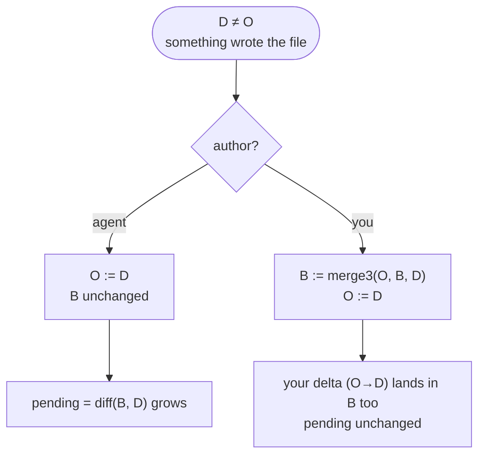
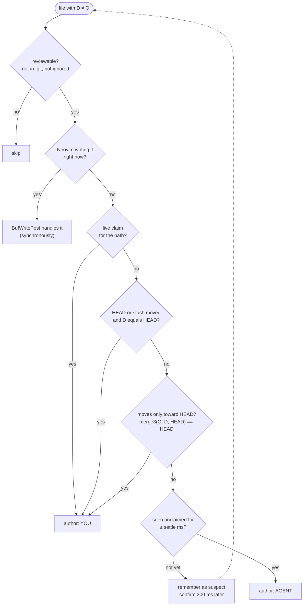
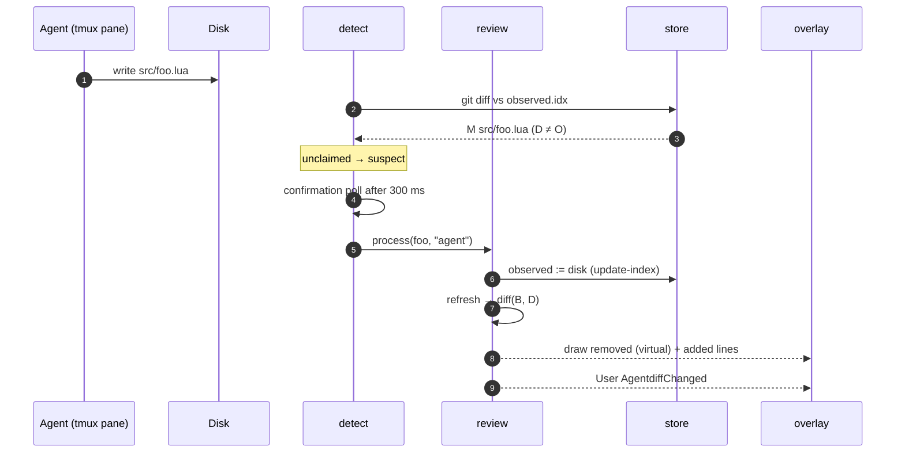
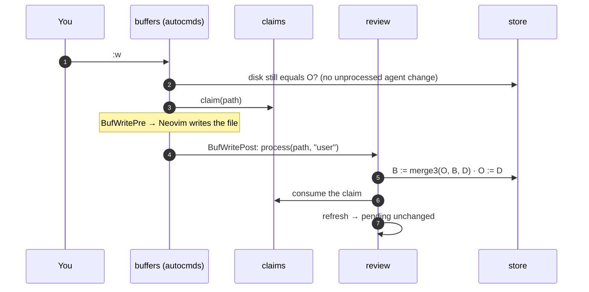
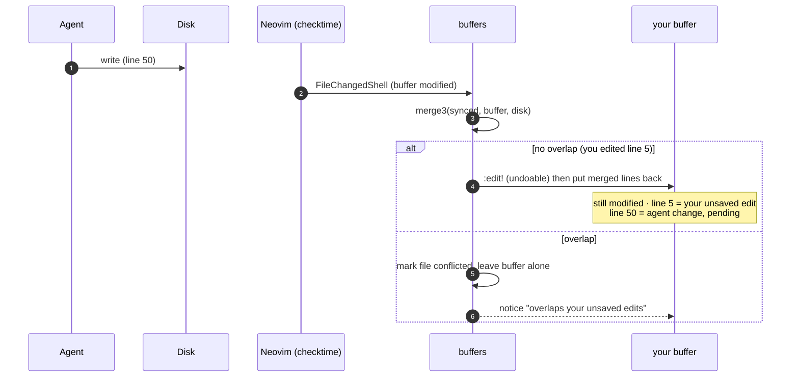
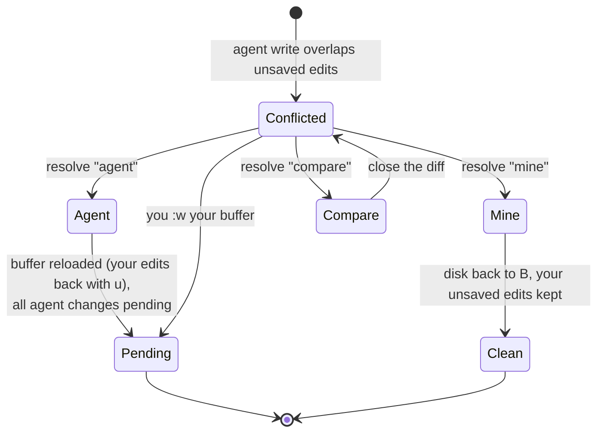
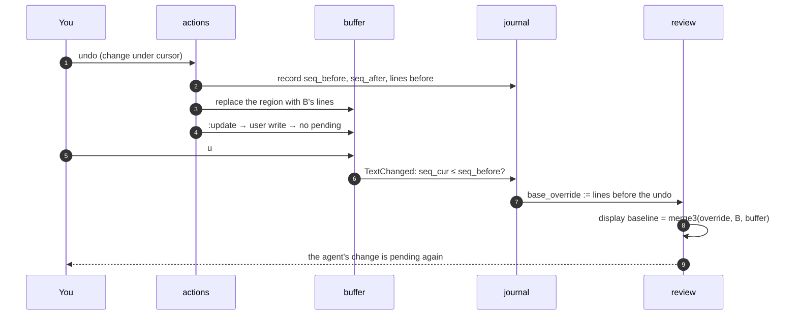
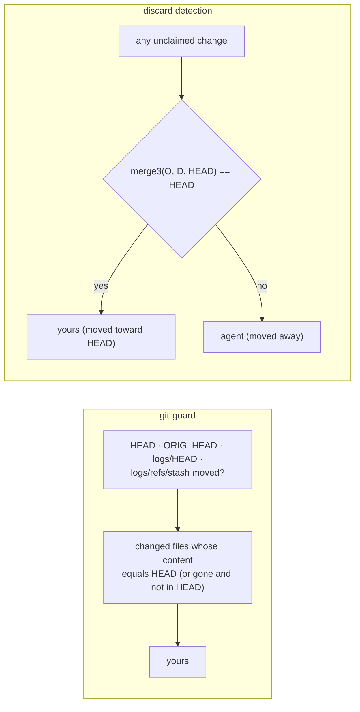

# Attribution: who changed what

VS Code knows which edits came from its agent because the agent edits
*through* the editor. A CLI agent in another tmux pane writes straight to
disk, so agentdiff can't ask the agent anything. It relies on one fact
instead:

> **Neovim knows every write it makes. Any change on disk that Neovim didn't
> make (and that nobody claimed) is the agent's.**

No hooks, no configuration of Claude Code, Copilot CLI or Codex.

- [The author rule](#the-author-rule)
- [How a disk change gets its author](#how-a-disk-change-gets-its-author)
- [Scenarios](#scenarios)
  - [An agent edits a file](#an-agent-edits-a-file)
  - [You edit and save](#you-edit-and-save)
  - [You edit inside a pending change](#you-edit-inside-a-pending-change)
  - [An agent writes a file you have unsaved edits in](#an-agent-writes-a-file-you-have-unsaved-edits-in)
  - [The writes overlap: a conflict](#the-writes-overlap-a-conflict)
  - [Undo, and undoing the undo](#undo-and-undoing-the-undo)
  - [Git operations and discards](#git-operations-and-discards)
- [What is never reviewed](#what-is-never-reviewed)

## The author rule

Recall the three texts: **B** (baseline), **O** (last processed disk),
**D** (disk now). See [architecture](architecture.md#data-model-three-texts-per-file).



`merge3(base, ours, theirs)` applies the changes base→ours and base→theirs
that neither overlap nor touch, and keeps **ours** where they do. With
`base = O`, `ours = B`, `theirs = D`:

- your edits in regions without pending changes are copied into B, so they
  never show up as pending;
- your edits *inside* (or touching) a pending change are not copied, so they
  become part of that change; keep accepts them, undo discards them.

That single rule covers saving, formatters, LSP edits, shell commands,
claimed tool writes and multi-instance writes. [merge3](merge3.md) explains
the algorithm.

## How a disk change gets its author

Every poll lists files where `D ≠ O` (two stat-cheap git queries) and
classifies each:



Where claims come from:

| Writer | How it becomes "yours" |
|---|---|
| `:w`, `:update`, format-on-save, anything writing a buffer | `BufWritePre` claims the path, `BufWritePost` processes it as yours |
| `:!cmd`, `:{range}!filter`, `:r !cmd`, `:w !cmd` | before: pending changes are settled as the agent's; after `ShellCmdPost`/`ShellFilterPost`: every change found is yours |
| oil.nvim, grug-far, any tool | the host calls `claim(paths)` (directories expand to every file under them) |
| another Neovim on the same project | its `BufWritePre` claim lands in the shared `claims/` directory |
| git checkout / pull / reset / stash / commit | git-guard: HEAD moved and the content equals HEAD |
| lazygit discard, `git restore`, `git checkout -- f` | discard detection: the change only moves the file toward HEAD |

A claim is consumed when the change it covers is processed (and expires
after `claim_ttl` if nothing used it), so an agent edit right after your save
is the agent's again.

## Scenarios

### An agent edits a file



### You edit and save



If the disk had an unprocessed agent change at `BufWritePre` (you saved
before the poll saw it), that change is processed as the agent's first, then
your write. A save never silently keeps an agent change.

### You edit inside a pending change

```
base O : a   two   c          (what the agent wrote: "TWO")
B      : a   two   c          baseline
D      : a   TWO!  c          you changed the agent's line and saved

merge3(O = a TWO c, B = a two c, D = a TWO! c)
  base→ours  : line 2  TWO → two
  base→theirs: line 2  TWO → TWO!     overlap → ours wins
  B'         : a two c        → line 2 still pending, now "TWO!"
```

### An agent writes a file you have unsaved edits in

Neovim's "file changed on disk" prompt never appears. agentdiff handles
`FileChangedShell` and merges:



The `:edit!` + reapply step makes Neovim's own timestamp match the disk, so a
later `:w` doesn't hit "the file has been changed since reading it".

### The writes overlap: a conflict



### Undo, and undoing the undo

Undo edits the buffer (loading it hidden if needed) and writes it, so it's an
ordinary user write: the region goes back to B. To make `u` bring the agent's
change back *as pending*, agentdiff records the undo sequence number:



If the buffer had unsaved edits of yours, Undo leaves its result unsaved with
them (it doesn't write your unrelated edits behind your back); it reaches
disk on your next `:w`.

### Git operations and discards

Two separate checks keep git from looking like an agent:



| You do | HEAD moves? | Detected by |
|---|:---:|---|
| `git switch`, `pull`, `reset --hard`, `stash` | yes | git-guard |
| `git commit` (worktree unchanged) | yes | nothing changes on disk, pending stays pending |
| lazygit "discard" of a file, `git restore f`, `git checkout -- f` | no | discard detection |
| lazygit "discard" of one hunk (`git apply -R`) | no | discard detection (partial moves count) |
| agent edits and `git add`s | no | moves away from HEAD → shown as the agent's |

Limitation: discarding unstaged changes while *other* changes to the same
file are staged moves the file toward the index, not HEAD, and is shown.

## What is never reviewed

- anything inside a `.git` directory (commit messages, rebase todos, hooks);
- paths ignored by the project's `.gitignore` files or the `excludes` option
  (`node_modules/`, build and cache directories, swap files…);
- nested git repositories;
- the whole project when its root would be `~` or `/`, or it has more than
  `max_files` files.
