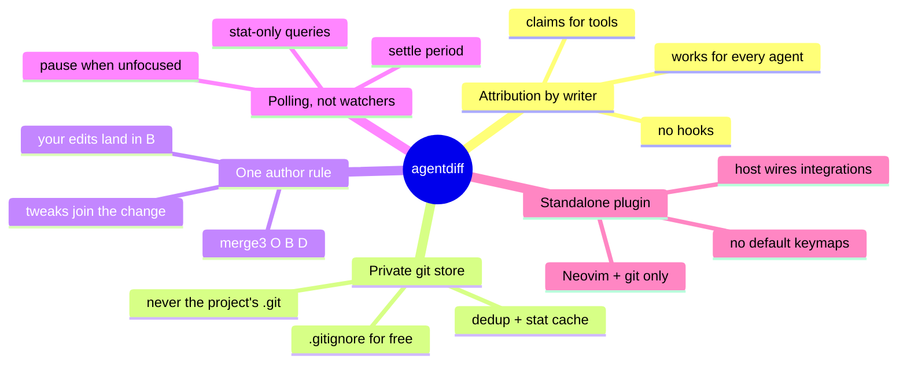

# Design decisions

Why agentdiff is built the way it is, and how it compares with VS Code.

## Compared with VS Code's agent mode

| | VS Code agent mode | agentdiff |
|---|---|---|
| Where the agent runs | inside the editor | any CLI agent, in another tmux pane |
| How edits are attributed | the agent edits through the editor | Neovim's own writes are yours; everything else is the agent's |
| Baseline | the file just before the agent's first edit | a per-project snapshot kept current with your edits |
| Inline diff, keep / undo per change, file, all | ✓ | ✓ |
| Partial keep / undo of selected lines | — | ✓ |
| Changed-files list | chat panel | panel + statusline + file-tree marks |
| Agent configuration needed | — | none |
| Pending changes survive a restart | ✓ | ✓ (persisted store) |
| Non-agent writers (a build script) | not shown | shown unless ignored |

The one place where "identical" becomes "nearly identical" is the last row:
a program that isn't an agent but writes into the project from outside Neovim
looks like an agent. `.gitignore` covers most build output.

## Decisions

### Attribution by writer, not by agent integration

Agents have hooks, and Claude Code and Copilot CLI even speak an IDE
protocol, but each is different, may not be configurable on a work machine,
and the IDE protocol is about approving edits *before* they land. agentdiff
reviews after the fact, so all it needs is to know which writes were
Neovim's. That's knowable for every agent without touching any of them.

### A private git directory as the store

Alternatives: in-memory snapshots (lost on restart, can't cover files never
opened), copying the tree (slow, no dedup), refs in the project's own
repository (pollutes it, fails outside git). A private git dir gives
content-addressed storage, stat-cached comparisons and `.gitignore` handling
for free, and works in any directory. Found while building it: `git add -A`
aborts on a nested repository, so snapshots use `ls-files -o` +
`update-index`, which reports nested repositories as `dir/` and skips them.

### One rule instead of special cases

"Baseline := disk on every save" would silently keep agent changes whenever
you press `:w`. Applying your delta with `merge3(O, B, D)` keeps agent
changes pending, lets your tweaks join them, and covers formatters, LSP
edits, shell commands, claims and other instances with the same code path.

### Polling instead of file watchers

`uv.fs_event` isn't recursive on Linux; one watcher per directory doesn't
scale to big trees. Two stat-only git queries per second, paused while
Neovim is unfocused, keep detection under 2 s with negligible cost.

### Settle period and consumed claims

Another instance's claim may arrive a moment after its write, so an
unclaimed change waits 300 ms before it's blamed on the agent. Claims are
consumed by the change they cover: with expiry alone, an agent edit within
10 s of your save would have passed as yours.

### Git-guard against HEAD, discards toward HEAD

Comparing against the project's *index* would hide an agent edit the agent
staged itself, so git-guard compares against HEAD and fires on HEAD or stash
movement. Discards don't move HEAD; they're recognised because they only move
a file toward HEAD (`merge3(O, D, HEAD) == HEAD`).

### Never close a window

Deleting a buffer closes its windows; with neo-tree's `close_if_last_window`
that can quit Neovim. Buffers are swapped out of every window before they're
deleted.

### On/off with an epoch

Turning review off and on again must not show everything you did in between
as agent changes. Each store records the epoch it was built in and is
rebuilt from disk when review was turned off since.

### Standalone

The plugin depends on Neovim and git only and registers no keymaps unless
asked. Integrations (oil, grug-far, neo-tree, lualine, colorschemes) are
host-side recipes built on `claim()`, `path_status()`, `status()` and
`User AgentdiffChanged`.
