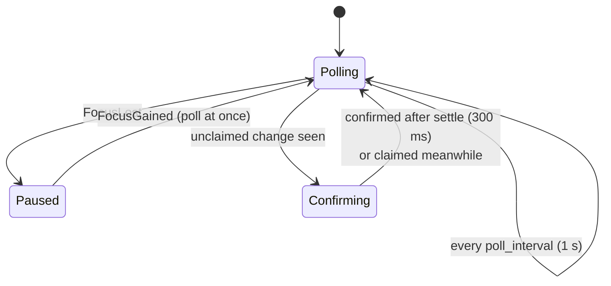
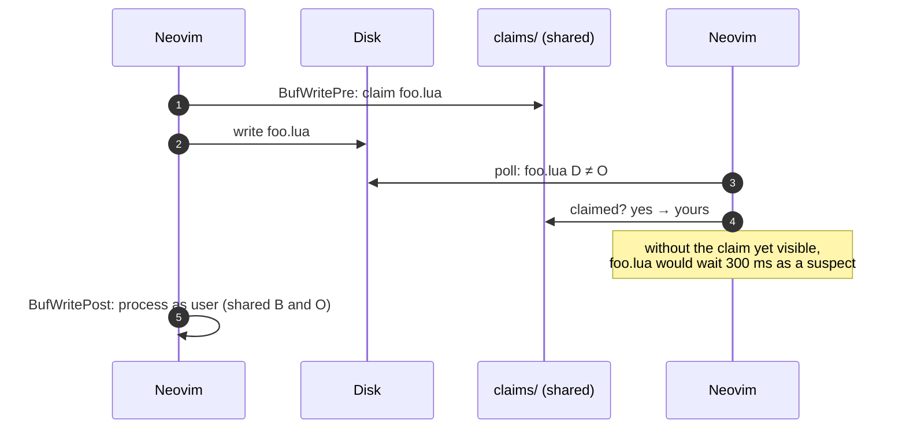
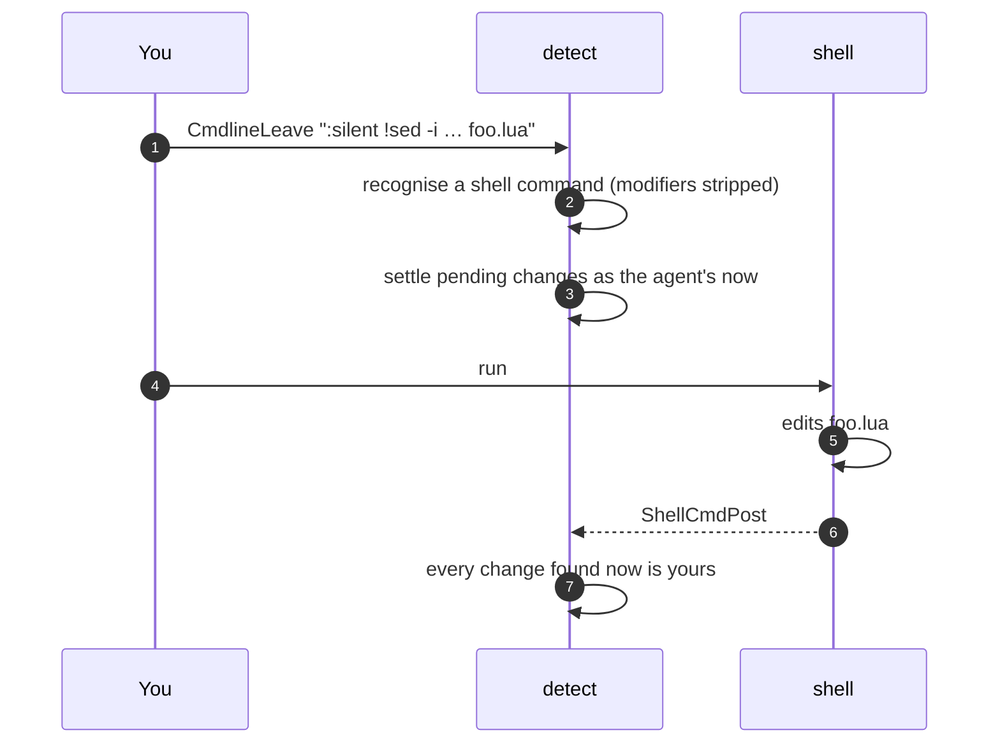
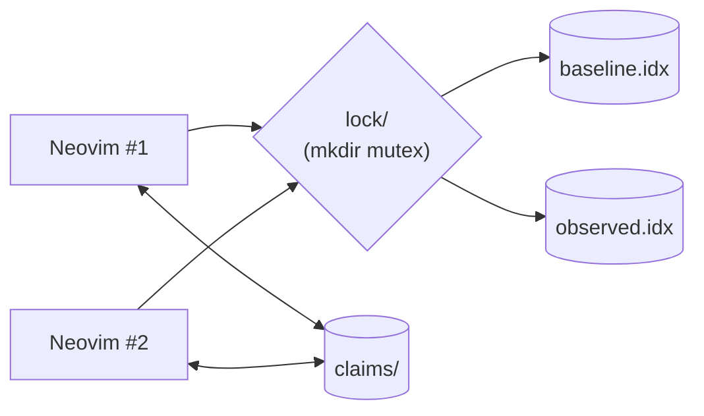
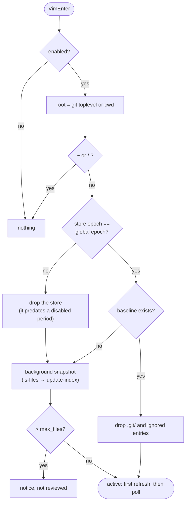

# Detection

How agentdiff notices disk changes, how fast, and how it avoids blaming the
agent for writes that aren't its own.

- [The poll loop](#the-poll-loop)
- [Timing](#timing)
- [The settle period](#the-settle-period)
- [Shell commands run from Neovim](#shell-commands-run-from-neovim)
- [Several Neovim instances on one project](#several-neovim-instances-on-one-project)
- [Startup and restarts](#startup-and-restarts)
- [Cost](#cost)

## The poll loop

There are no file watchers: libuv's `fs_event` isn't recursive on Linux, and a
watcher per directory doesn't scale. Instead, while Neovim is focused, a timer
runs two git queries against the **observed** index:

```
git diff --name-status -z --no-renames        # tracked files whose content differs from O
git ls-files -o --exclude-standard -z          # files O doesn't have (new, not ignored)
```

Both compare stat data first, so an unchanged tree costs a few milliseconds.



Extra polls also run on `BufEnter` (throttled to 200 ms) and synchronously
around shell commands. With tmux `focus-events on`, switching to the Neovim
pane gains focus and polls immediately.

## Timing

Worst case from the agent's write to the overlay, while Neovim is focused:

```mermaid
gantt
    dateFormat X
    axisFormat %L ms
    title Agent write → pending change (worst case, focused)
    section Agent
    write lands just after a poll    :milestone, 0, 0
    section agentdiff
    wait for the next poll           :a1, 0, 1000
    poll sees D ≠ O (suspect)        :a2, 1000, 1030
    settle period                    :a3, 1030, 1330
    confirmation poll, process       :a4, 1330, 1380
    refresh + draw                   :a5, 1380, 1420
    section Requirement
    detected within 2 s              :crit, 0, 2000
```



| Situation | When the change shows |
|---|---|
| Neovim focused | ≤ ~1.4 s (spec: ≤ 2 s) |
| Neovim unfocused | on focus gain (the timer is paused) |
| Neovim not running | at the next start, from the persisted store |
| a buffer showing the file | the buffer reloads (or merges) right after processing |

## The settle period

A newly seen, unclaimed change isn't blamed on the agent at once. It becomes
a *suspect*, and a confirmation poll `settle` ms later decides. That window
lets claims from other places arrive first:



Short-lived files (a formatter's temp copy, an editor's swap file outside the
excludes) usually disappear inside the settle period and are never reported.

## Shell commands run from Neovim



Recognised: `:!cmd`, `:{range}!filter`, `:r !cmd`, `:w !cmd`, behind any of
`:silent`, `:keepalt`, `:verbose`, `:noautocmd`, … (`:w!`, a forced write, is
not a shell command).

## Several Neovim instances on one project

All instances share one store, so the baseline is the same everywhere:



- Writes by either instance are claimed in `claims/` and processed under the
  store lock; processing is idempotent (`merge3(D, B, D) == B`), so it
  doesn't matter which instance gets there first.
- git's own `index.lock` serializes index writes; agentdiff retries with
  back-off.

## Startup and restarts



Because B and O persist, an agent that worked while Neovim was closed is
noticed at the next start: those files simply have `D ≠ O`.

## Cost

| Operation | Typical cost |
|---|---|
| poll on an unchanged tree | 2 git processes, stat-only |
| an unprocessed change | `cat-file --batch` reads + one `update-index` |
| a discard check | one read-only `cat-file --batch` on the project (`HEAD:path`) |
| your `:w` | 1 read + 1 write of the store indexes, synchronous |
| first snapshot | proportional to project size, in the background |
| a buffer's overlay | one in-memory `vim.text.diff` per change, debounced 100 ms |
