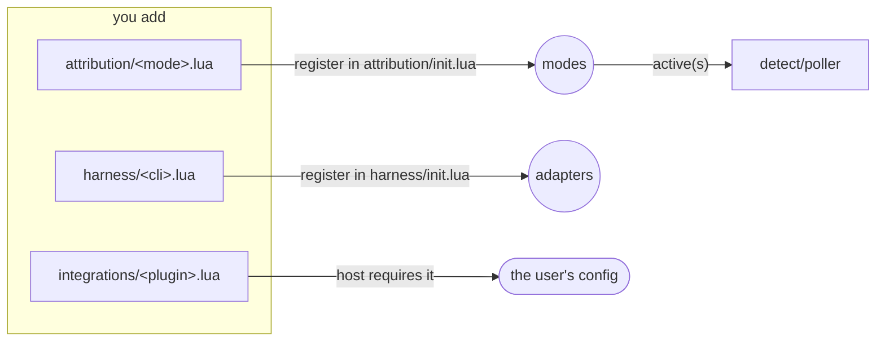

# Extending agentdiff

Three things are meant to be added without touching the rest of the code: an
**attribution mode**, a **harness adapter** and an **integration**. Each is
one new file plus one registration line. The dependency rule in
[architecture.md](architecture.md#module-map) still applies: a module may only
require modules on its own level or below, and `tests/layers_spec.lua` checks
it.



## An attribution mode

A mode decides who changed each file the poller found changed on disk.

```lua
---@class MyMode: AgentdiffAttribution
local M = { name = "mymode" }

---@param s AgentdiffSession
---@param changes AgentdiffChange[]      { path, status = "M"|"D"|"A" }, D ≠ O
---@param ctx AgentdiffAttributionCtx    mode, now, guard_moved, produced(), discarded()
---@return AgentdiffAttributionResult    { agent = {...}, user = {...}, wait = {...} }
function M.classify(s, changes, ctx)
  local r = { agent = {}, user = {}, wait = {} }
  for _, c in ipairs(changes) do
    -- decide, e.g. from a journal, a process list, a time window…
  end
  return r
end

---Optional: forget per-session state when review stops.
function M.reset() end

return M
```

Rules:

- **Respect forced authors.** `ctx.mode` is `"user"` right after a shell
  command run from Neovim, and `"agent"` just before one; honour it like
  `writer` does.
- **Skip what Neovim is writing.** Leave out paths in `s.writing`
  (`BufWritePost` processes them) and paths `session.reviewable()` rejects.
- **`wait` means "look again".** The poller schedules another poll after
  `settle` ms whenever `wait` is non-empty.
- **Reuse the git helpers through `ctx`.** `ctx.produced(paths)` (content git
  itself put there) and `ctx.discarded(paths)` (changes that only move toward
  HEAD) avoid requiring `detect/`.

Register it in `attribution/init.lua` with `M.register(require("agentdiff.attribution.mymode"))`.
`attribution.active(s)` picks the mode for a session; today it is always
`writer`, and an option to choose the mode belongs there.

## A harness adapter

An adapter connects one agent CLI (Claude Code, Copilot CLI, Codex…) to
agentdiff: it reads the JSON the CLI passes to a hook, and installs or removes
agentdiff's hook in the CLI's configuration.

```lua
---@class MyCli: AgentdiffHarness
local M = { name = "mycli" }

---@param payload table   the hook's JSON from stdin
---@return AgentdiffHarnessReport?  { phase = "pre"|"post", paths = { abs… }, session? } or nil
function M.parse(payload) end

---@param scope "user"|"project"
---@param opts table
---@return boolean ok, string? message
function M.install(scope, opts) end
function M.uninstall(scope, opts) end

---@return AgentdiffHarnessStatus  { installed, where? }
function M.status(opts) end

return M
```

Rules:

- **`parse` is pure.** It returns nil for payloads that aren't file edits; it
  must not touch Neovim state.
- **`install` merges.** It edits the CLI's configuration without dropping
  anything else in it, and is idempotent (installing twice changes nothing).
- **Absolute paths.** Return absolute paths; the caller maps them to the
  project.

Register it in `harness/init.lua`.

## An integration

An integration is glue between agentdiff and another plugin, loaded only when
the host asks for it.

Rules:

- **Public API only.** Require only `agentdiff` (the public module) and,
  lazily, the other plugin, inside the function that needs it, never at the
  top of the file. Requiring the module must work when the other plugin isn't
  installed.
- **Don't wire anything on require.** Export plain functions (`component`,
  `setup`, hooks) and let the host call them.
- **Prefer events and claims.** Use `User AgentdiffChanged` to react to
  changes, `path_status()` / `status()` / `files()` to read state, and
  `claim(paths)` when the other plugin writes files itself.

The existing ones, `integrations/neotree.lua`, `integrations/oil.lua` and
`integrations/grug_far.lua`, are short examples of each pattern.

## Tests

Every new file gets a spec in `tests/`; every spec scenario gets a test named
after it. `make test` runs the suite headless; `tests/layers_spec.lua` fails
if the new module requires something above its level.
