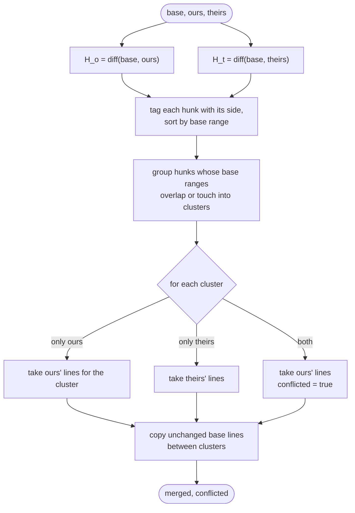
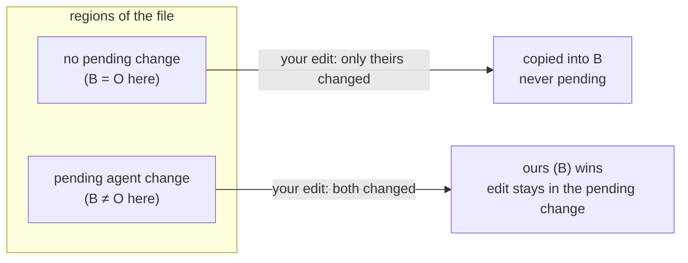

# merge3: the three-way merge

`merge.lua` is the only algorithmic piece of agentdiff, and it's pure: line
arrays in, line arrays out, no I/O. It's used for three things:

| Use | base | ours | theirs | Result |
|---|---|---|---|---|
| a user change lands in the baseline | O | B | D | new B |
| display baseline for unsaved buffers | O | B | buffer | baseline to diff the buffer against |
| agent write into a buffer with unsaved edits | synced disk | buffer | new disk | merged buffer, or "conflict" |
| discard detection | O | D | HEAD | equals HEAD ⇒ the change moved toward HEAD |
| keep in a buffer with unsaved edits | display B | B | display B with the hunk kept | new B |

## Hunks

`merge.diff(a, b)` wraps `vim.text.diff` (histogram algorithm) and returns
half-open, 0-based ranges: `[a_lo, a_hi)` of the old side becomes
`[b_lo, b_hi)` of the new side. An empty range is an insertion point.

```
a = { "a", "b", "c", "" }          b = { "a", "B", "c", "d", "" }

hunk 1  a[1,2) → b[1,2)    "b" → "B"         changed
hunk 2  a[3,3) → b[3,4)    insert "d"        added
```

## The algorithm



Each side's lines for a cluster `[L, H)` are found with running offsets:
`side_lo = L + Δbefore`, `side_hi = H + Δbefore + Δinside`, where Δ is the
line-count change of that side's hunks before and inside the cluster.

Touching changes (one ends where the other starts) count as overlapping,
like `git merge-file`, so an edit right next to an agent change joins that
change instead of slipping into the baseline.

## Worked examples

### Disjoint edits: both applied

```
base    a  b  c  d  e
ours    a  B  c  d  e        (changed b)
theirs  a  b  c  d  E        (changed e)
merged  a  B  c  d  E        conflicted = false
```

### Overlap: ours wins

```
base    a  b   c
ours    a  B1  c
theirs  a  B2  c
merged  a  B1  c             conflicted = true
```

### Touching: treated as overlap

```
base    a  b  c  d
ours    a  B  c  d           (changed b, base [1,2))
theirs  a  b  C  d           (changed c, base [2,3))  touches → one cluster
merged  a  B  c  d           conflicted = true
```

### Offsets after insertions

```
base    a  b  c  d  e
ours    a  x1 x2 b  c  d  e  (inserted 2 lines after a)
theirs  a  b  d  E           (deleted c, changed e)
merged  a  x1 x2 b  d  E     conflicted = false
```

## Why it gives the "VS Code" behaviour

With `merge3(O, B, D)` for your writes:



That's exactly "your edits never become agent changes; your tweaks to an
agent change are part of it".
