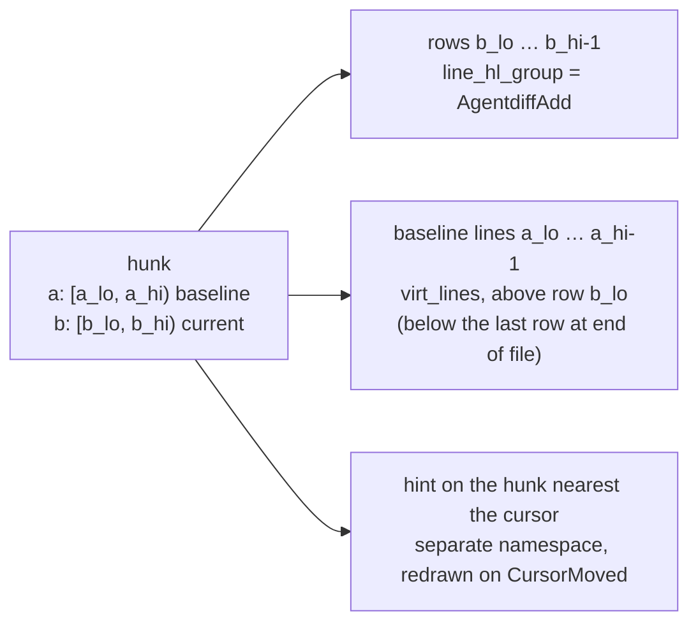
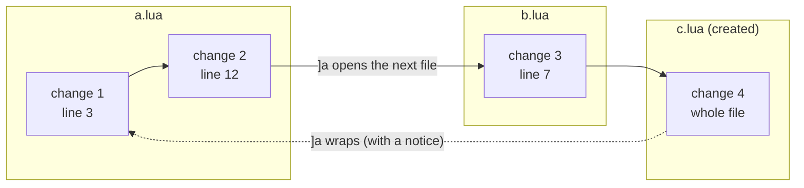
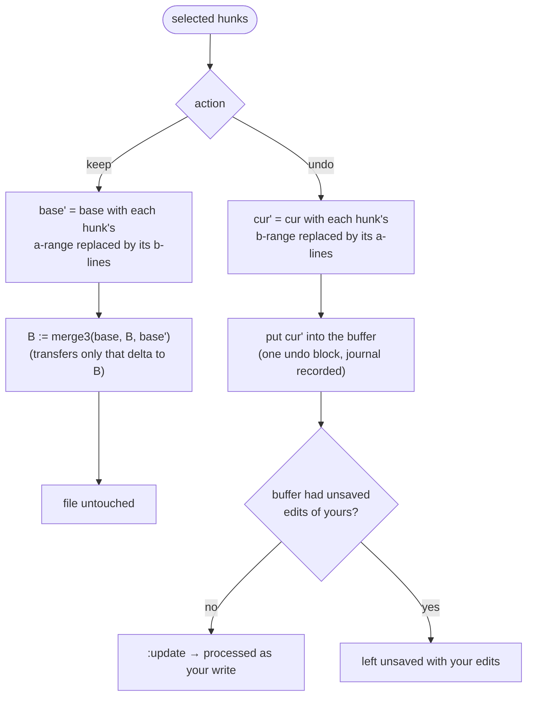
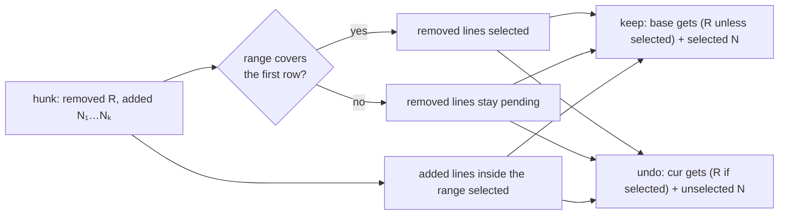
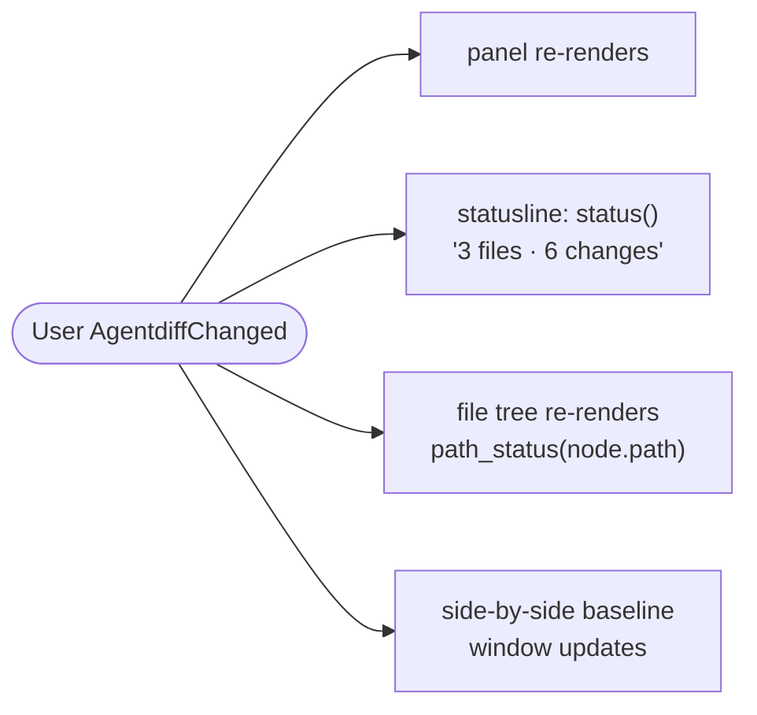

# The review UI

What you see and how each action changes the baseline or the file.

- [The inline overlay](#the-inline-overlay)
- [Navigation order](#navigation-order)
- [Keep and undo](#keep-and-undo)
- [Partial keep and undo](#partial-keep-and-undo)
- [Created, deleted and binary files](#created-deleted-and-binary-files)
- [Panel, side-by-side view, statusline, file tree](#panel-side-by-side-view-statusline-file-tree)

## The inline overlay

The buffer always holds the file exactly as it is on disk. Everything else is
extmarks in the `agentdiff` namespace:

```
  9 │ local function load(path)
    │ local f = io.open(path)                    ← removed line: virt_lines above, AgentdiffDelete
 10 │ local f = assert(io.open(path, "r"))       ← added line: line highlight, AgentdiffAdd
    │                    agent 2/5 · <leader>rk keep · <leader>ru undo   ← hint, right-aligned
 11 │ return f:read("a")
```



- No signs are placed, so gitsigns keeps the sign column.
- The overlay is redrawn 100 ms after the buffer stops changing, and right
  away after detection, keep or undo.
- Conflicted files use `AgentdiffConflict` for their added lines.
- A leftover buffer of a file the agent deleted is shown entirely in
  `AgentdiffDelete`.

## Navigation order

Changes are ordered by file path, then by line. That flat list gives the hint
its "2/5" position and drives `]a` / `[a`:



`]A` / `[A` move between files, landing on their first change.

## Keep and undo

Both work on the review state of one file: `base` (display baseline lines),
`cur` (current lines) and the hunks between them.



Keep transfers the change through `merge3` so that, in a buffer with unsaved
edits, only the kept hunk reaches B and none of your unsaved typing does.

## Partial keep and undo

With a line range (visual mode, or `:10,12Agentdiff keep`), only the
selected part of each hunk is used. A hunk's removed lines count as selected
when the range covers the hunk's first row:

```
baseline       current            selection: lines 10–11
  l9             l9
                 n10   ← added    ✓ selected
                 n11   ← added    ✓ selected
                 n12   ← added
                 n13   ← added

keep (partial):  base' = l9 n10 n11          → n12, n13 still pending
undo (partial):  cur'  = l9 n12 n13          → n12, n13 still pending
```



## Created, deleted and binary files

| File | Keep | Undo |
|---|---|---|
| created by the agent | B := its content | delete it, wipe its buffer (windows keep a buffer) |
| deleted by the agent | B := absent | write B's content back |
| binary or over `max_file_size` | B := disk | write B's bytes back |
| renamed | a deletion plus a creation | |

## Panel, side-by-side view, statusline, file tree

```
 agentdiff  3 files · 6 changes          ← panel (<leader>rr)

 M src/a.lua  +3 −1
 A src/new.lua  +20 −0
 D old.lua  +0 −12

 <CR> open  K/U keep/undo file  gK/gU all  q close
```



- **Side-by-side** (`<leader>rv`): a read-only scratch buffer with the
  baseline in a vertical split, both windows in diff mode; the inline overlay
  is hidden for that buffer meanwhile. Keep and undo work from either window
  (from the baseline window, the change is found by its baseline range).
- **File tree**: `path_status(path)` returns `"file"`, `"dir"` or `nil` from
  sets rebuilt only when the pending signature changes, so a tree can call it
  for every line it draws.
