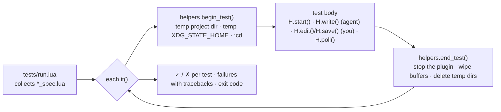
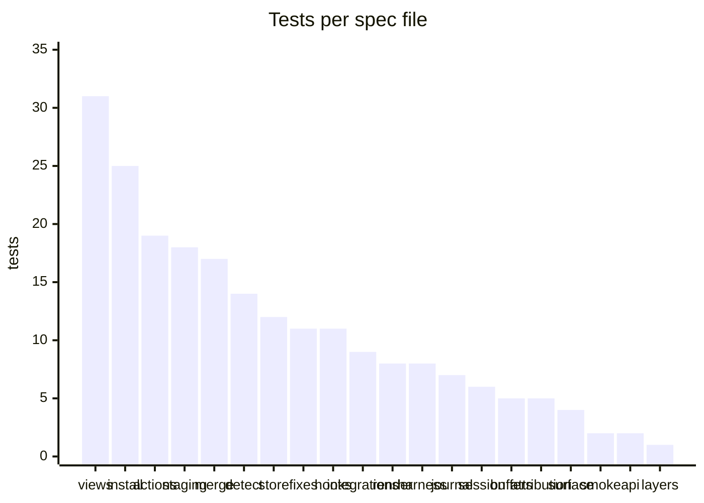
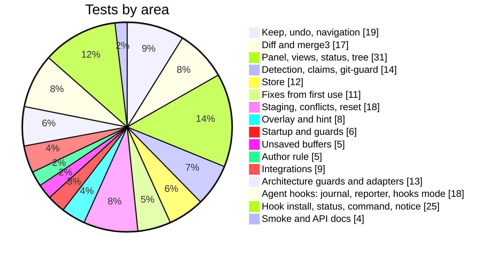

# Testing

The suite runs headless, with no test framework and no dependencies:

```sh
nvim --headless -u NONE -l tests/run.lua           # everything
nvim --headless -u NONE -l tests/run.lua detect    # spec files whose name contains "detect"
make test                                          # the same, via the Makefile
```

It exits non-zero when a test fails, so it works as-is in CI.

## How a test runs



- **The agent** is simulated with plain `io.open` writes: unclaimed changes
  from outside Neovim, exactly what an agent produces.
- **You** are simulated with buffer edits, `TextChanged` and `:write`, which go
  through the real autocmds.
- **Detection** is driven synchronously with `agentdiff._test.poll_now()`; the
  poll timer is off (`poll_interval = 0`) except in the live-update test,
  which uses the real timer and asserts the 2-second budget.
- **A second Neovim instance** is a real `nvim --headless` process sharing the
  test's store.
- **git** runs with an isolated config and `GIT_OPTIONAL_LOCKS=0`, so the
  tests' own `git status` can't touch `.git/index` behind the plugin's back.

## What's covered

215 tests in 20 spec files.





| Spec file | What it checks |
|---|---|
| `merge_spec` | line arrays, hunk kinds, merge3 (disjoint, overlap, touching, offsets, empty sides), CRLF helpers |
| `store_spec` | store isolation (the project's `.git` is never modified), non-git dirs, ignores, nested repos, raw bytes, lock retry |
| `session_spec` | background snapshot, startup guards (`~`, `max_files`), store reset |
| `attribution_spec` | your edits never pending, format on save, tweak then keep, saving keeps changes pending |
| `detect_spec` | detection, the 2 s live update, settle, shell commands, claims, a real second instance, git-guard, persistence |
| `buffers_spec` | merging agent writes into unsaved buffers, conflicts and their resolutions |
| `render_spec` | overlay geometry, untouched buffer text, highlights, hint position, hide/show |
| `actions_spec` | navigation, keep and undo at every scope, undoing an undo, created/deleted/renamed files, partial ranges |
| `views_spec` | the panel (tree and list views, folding, colours and icons, view toggling, position and size, the panel window never taken over), side-by-side, binary files, command, change event, status, `path_status` |
| `staging_spec` | staging keeps (file, hunk, `commit -a`, created and deleted files, unstaging, the option), the startup check and committed deletions, keep and undo ending a conflict, reset |
| `fixes_spec` | commit messages, ignored files, discards through git, windows never closed, the persisted toggle |
| `api_spec` | every function and subcommand in the README exists, and the subcommand table matches the code |
| `integrations_spec` | neo-tree component and renderers, oil and grug-far claims, integrations staying optional |
| `surface_spec` | the public API, subcommands, options and highlight groups stay exactly as they are |
| `layers_spec` | the dependency rule: no module requires one on a higher level |
| `harness_spec` | the harness adapter registry; the Claude Code and Copilot CLI payload parsers (Edit, Write, MultiEdit, NotebookEdit, camelCase and VS Code-style payloads, patches, non-edit tools) |
| `journal_spec` | the agent journal (concurrent reports, consumption, late duplicates, gc) and the `attribution` option |
| `hooks_spec` | the reporter run as a real `nvim -l` process (store lookup, non-edit payloads, files outside projects, always exit 0) and the hooks mode (reported edit, generated file, shell edit, one change per report, Neovim closed, a late post report) |
| `install_spec` | installing, reinstalling and uninstalling both harnesses at both scopes in temp directories, invalid JSON, quoting, `:Agentdiff hooks` status after a real hook run, completion |
| `smoke_spec` | the plugin loads; per-test fixtures work |

Each spec scenario from the original OpenSpec change has a test named after
it, e.g. `(Discard one hunk)` or `(Undo is undoable)`.

## Other checks

```sh
stylua --check lua tests bin                                 # formatting
lua-language-server --check=lua/agentdiff --checklevel=Warning   # types (LuaCATS)
```

The modules carry LuaCATS annotations; lua_ls must report no problems. Run
lua_ls from inside Neovim (or point it at an unpacked runtime) so
`$VIMRUNTIME/lua` is available as a library.
